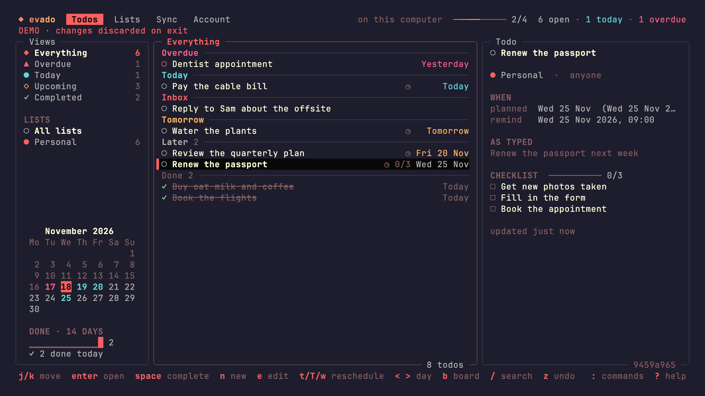

# Evado in the terminal

A todo app for the terminal. It works with no account, keeping your todos in
a file on your computer. With an [Evado](https://evado.app) account it syncs
them with your other devices and the people you share lists with.



That is `evado -demo`, the sample todos the app ships with.

## Install

```sh
brew install nerdlabz/tap/evado
```

or, with Nix:

```sh
nix run 'github:nerdlabz/evado-tui?dir=packaging/nix'
```

There are also archives for macOS, Linux and Windows on the
[Releases](https://github.com/nerdlabz/evado-tui/releases) page, and
`go install github.com/nerdlabz/evado-tui/cmd/evado@latest` works.
[Installing Evado](docs/install.md) has the details, including NixOS.

## Start

Try it first. This opens sample todos, saves nothing, and touches no account:

```sh
evado -demo
```

Then run it for real:

```sh
evado
```

The first screen asks how you want to start:

- **Use without an account.** Your todos stay in a file on this computer.
  You can sign in later, and they are added to your account.
- **Sign in.** Evado opens your browser, where you sign in or create an
  account. On a machine with no browser, use an emailed code or an API token
  instead.

[Getting started](docs/getting-started.md) covers each way to sign in, and
how to sign out.

## Add a todo

Press `n` and type it the way you would say it:

```
Call the bank tomorrow at 3pm
Take out the bins every wednesday
Renew the passport in 2 weeks
```

The line under the title shows how the date was read before you save.
A todo with no date goes to the inbox.

## Keys to know

| key | does |
| --- | --- |
| `j` / `k` | move down or up |
| `enter` | open the todo |
| `space` | complete it |
| `n` | new todo |
| `N` | several todos, one per line |
| `e` | edit |
| `t` / `T` / `w` | move to today, tomorrow or next week |
| `/` | search |
| `:` | every command, searchable |
| `?` | every key for the screen you are on |
| `q` | quit |

[Using the app](docs/using.md) has all of them, with saved views, the board
and how dates are read.

## From a script or an agent

The same binary has commands that never open the app:

```sh
evado add "Call the bank tomorrow 3pm"
evado ls -status today
evado done 3fa9c1
evado -local add "Water the plants friday"   # the todos on this computer, no account
```

Every command takes `-json`, and `evado help` lists them.
[AGENTS.md](AGENTS.md) is the full reference, with exit codes and how to
point an AI agent at your todos.

## More

- [Installing Evado](docs/install.md)
- [Getting started](docs/getting-started.md): the ways to sign in, signing out
- [Using the app](docs/using.md): keys, saved views, dates
- [Offline first, and how sync works](docs/sync.md)
- [Configuration](docs/configuration.md): flags, the config file, themes
- [Import and export](docs/import-export.md)
- [AGENTS.md](AGENTS.md): the command line, for scripts and agents

## Contributing

Bug reports, ideas and pull requests are welcome. Start with
[CONTRIBUTING.md](CONTRIBUTING.md); [docs/development.md](docs/development.md)
shows how to build and test. To report a security problem, see
[SECURITY.md](SECURITY.md).

## License

MIT. See [LICENSE](LICENSE). Release archives include the notices for the
libraries Evado is built with.
